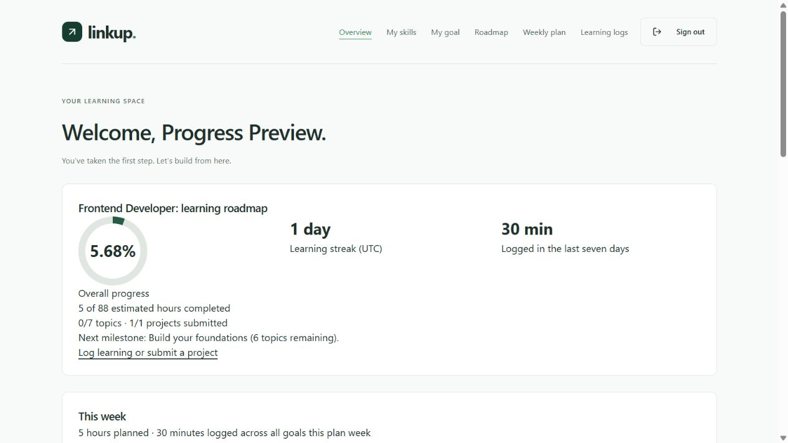
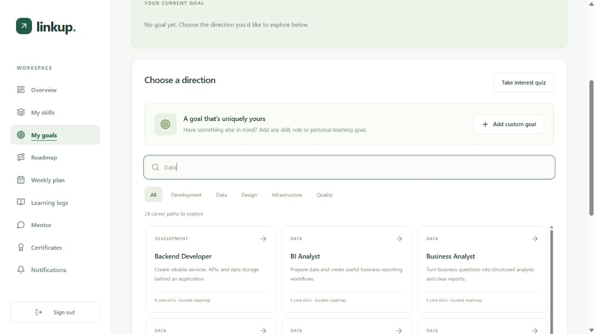
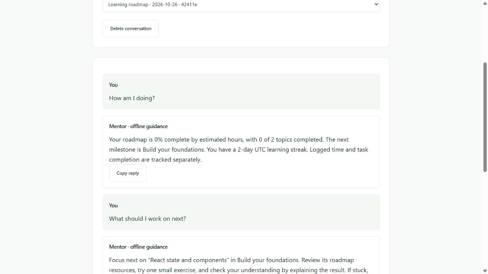

<div align="center">

# 🌱 linkup

### Little steps. New skills. Bigger possibilities.

Turn your career goals into a learning journey you can actually follow.

[✨ Open linkup](https://linkup-seven-gamma.vercel.app) · [🚀 Launch guide](docs/LAUNCH.md) · [📚 Build journal](docs/BUILD_PROGRESS.md)


</div>

---

## 🌷 A little about linkup

Knowing where you want to go is one thing. Knowing what to learn next is another.

**linkup** helps students, career switchers and curious learners connect their existing skills to their next goal. Find your skill gaps, build a roadmap, make room for learning in your week, and watch your progress grow.

> One goal, a clear next step, and a little progress every day.

## ✨ What's inside?

|                                | Your learning companion                                                                                                                 |
| ------------------------------ | --------------------------------------------------------------------------------------------------------------------------------------- |
| 🎯 **Goals that fit you**      | Explore 36 career paths, search the catalogue, try an interest quiz, or add a custom goal.                                              |
| 🧭 **A path forward**          | Compare your skills with role requirements and generate an ordered roadmap with practical projects.                                     |
| 🗓️ **A manageable week**       | Preview and save Relaxed, Standard, Intensive or Deadline plans. Replan while keeping completed work.                                   |
| 💬 **A mentor beside you**     | Gemini-powered streaming replies, conversation history, cancellation and retry. Offline guidance is available when live AI is disabled. |
| 🌿 **Progress you can see**    | Track tasks, learning logs, project evidence, streaks and progress charts.                                                              |
| 🏅 **Milestones to celebrate** | Completion certificates with PDF downloads, QR codes and public verification.                                                           |
| 💌 **Helpful nudges**          | In-app notifications, reminder preferences, email verification, password recovery and optional email reminders.                         |

Custom goals that do not match a supported skill or role receive a labelled general starter roadmap. Certificates reflect learner-reported completion; they are not accredited qualifications.

## 🪴 From someday to this week

```text
Choose a goal → Add your skills → Build a roadmap
                                        ↓
Celebrate progress ← Learn & practise ← Plan your week
```

## 🖼️ A peek inside



<details>
<summary>🎯 Explore goals</summary>



</details>

<details>
<summary>💬 Meet the mentor</summary>



</details>

_Screenshots show local QA accounts and an earlier UI snapshot. The mentor screenshot demonstrates offline guidance, not live Gemini output._

## 🧩 Built with

| Layer            | Tools                                                                      |
| ---------------- | -------------------------------------------------------------------------- |
| **Interface**    | React 18, TypeScript, Vite, Tailwind CSS, Lucide                           |
| **Forms & data** | React Hook Form, Zod, TanStack Query, Zustand, Axios                       |
| **API**          | Node.js, Express, TypeScript, JWT sessions                                 |
| **Database**     | PostgreSQL 16, Prisma 7                                                    |
| **Integrations** | Gemini for AI, Brevo for transactional email                               |
| **Hosting**      | Vercel and Neon                                                            |
| **Quality**      | Vitest, React Testing Library, Supertest, ESLint, Prettier, GitHub Actions |

The React app talks to an Express API. The API owns database access, provider calls, scheduling and certificate generation. Provider keys stay on the server.

## 🌱 Grow it locally

You will need **Node.js 24**, **npm 10+**, **Git**, and **Docker with Compose** (or a local PostgreSQL 16 database).

```sh
git clone https://github.com/neethu18reddy/LinkUp.git
cd LinkUp
npm ci
npm run setup:env
docker compose up -d postgres
npm run db:generate
npm run db:deploy
npm run dev
```

Open [http://127.0.0.1:5173](http://127.0.0.1:5173) and create an account. The migrations populate the skill and role catalogues automatically.

`setup:env` creates ignored local configuration files and generates missing session secrets. External providers are disabled by default, so you can explore the core learning flow without API keys.

<details>
<summary>🪟 Windows setup without Docker</summary>

After `npm ci` and `npm run setup:env`, replace the Docker step with:

```sh
npm run db:local:install
npm run db:local:start
npm run db:generate
npm run db:deploy
npm run dev
```

Stop the app with Ctrl+C, then run `npm run db:local:stop`. Your database lives in the ignored `.local/` directory. Keep that directory and its credentials to retain your accounts and progress; stop PostgreSQL before backing it up or syncing it.

</details>

<details>
<summary>🧸 Want sample learning data?</summary>

```sh
npm run setup:demo
npm run db:seed:demo
```

Demo credentials are kept in your ignored local backend environment file. There is no shared public demo password. See the [demo guide](docs/DEMO.md) for details.

</details>

### Handy commands

| Command                                    | What it does                                            |
| ------------------------------------------ | ------------------------------------------------------- |
| `npm run dev`                              | Start the frontend and API                              |
| `npm run check`                            | Check formatting, lint, types, tests, schema and builds |
| `npm run build`                            | Build both workspaces                                   |
| `npm run db:deploy`                        | Apply existing database migrations                      |
| `npm run db:migrate -- --name your_change` | Create a development migration                          |

## 🔐 Configuration & deployment

Use the [backend environment template](backend/.env.example) and [frontend environment template](frontend/.env.example) as references. Keep real credentials in ignored local files or private hosting environment settings. Never put secrets in `VITE_*` variables.

The hosted app is available at **[linkup-seven-gamma.vercel.app](https://linkup-seven-gamma.vercel.app)**. The latest launch checks confirmed database connectivity and a live Gemini mentor response. Brevo email is enabled; inbox delivery still needs owner confirmation. Google sign-in is optional and currently disabled by choice.

For exact provider variables, deployment steps and verification, use the [launch guide](docs/LAUNCH.md). A separate [Docker deployment guide](docs/DEPLOYMENT.md) is available for self-hosting. Provider availability and quotas depend on the configured accounts.

## 📚 The bookshelf

| Guide                                      | What you will find                                |
| ------------------------------------------ | ------------------------------------------------- |
| [Launch](docs/LAUNCH.md)                   | Hosting, private configuration and release checks |
| [Roadmaps](docs/ROADMAP_GENERATION.md)     | Skill gaps, generation and fallback behavior      |
| [Weekly planning](docs/WEEKLY_PLANNING.md) | Scheduling, previews and replanning               |
| [Mentor](docs/LEARNING_MENTOR.md)          | Conversations, streaming and provider behavior    |
| [Progress](docs/LEARNING_PROGRESS.md)      | Tasks, learning logs and project evidence         |
| [Certificates](docs/CERTIFICATES.md)       | Eligibility, PDFs and public verification         |
| [Notifications](docs/NOTIFICATIONS.md)     | Preferences, reminders and email                  |
| [Testing](docs/TESTING.md)                 | Automated checks and database integration tests   |
| [Build journal](docs/BUILD_PROGRESS.md)    | Implementation history and validation notes       |

Explore the [live API documentation](https://linkup-seven-gamma.vercel.app/api/docs/) or open [local Swagger](http://localhost:4000/api/docs/) while developing.

```text
frontend/        React pages, shared components and UI tests
backend/         Express API, Prisma schema, migrations and tests
docs/            Guides, screenshots and the build journal
deploy/          Deployment environment template
scripts/         Local setup and development helpers
```

---

<div align="center">

**Keep learning. Keep growing. Stay linked. 🌱**

Built with open-source tools and assistance from Codex. Dependency licenses belong to their respective authors.

</div>
